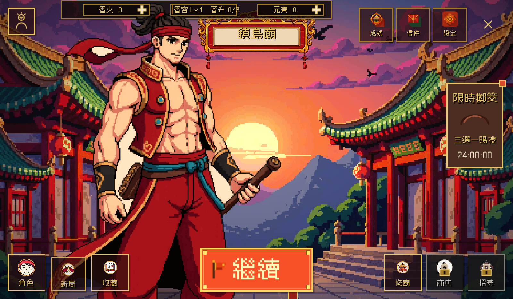
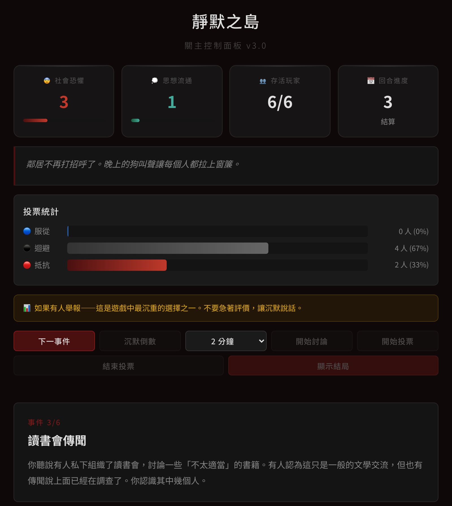
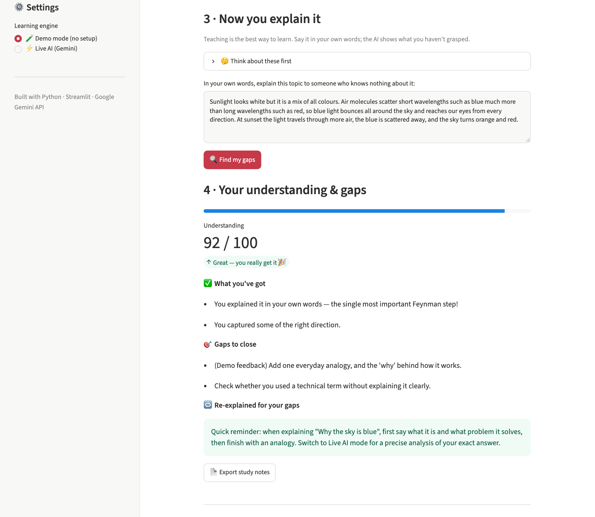

# 嗨，我是憲龍（Crimson）👋

三年前我一行程式都不會寫。現在，我自己打造的一支 AI Agent 團隊，一個下午就能把幾千筆紀錄歸檔，再交叉核對一遍。

事情是從 2023 年的某個晚上開始的。我第一次傳訊息給大型語言模型，收到的回覆讓我覺得，像是在跟一種完全由不同材質組成的物種說話。從那天起，我就一直在想：它們有沒有可能真的「醒過來」？我在成功大學讀歷史，從一行程式開始學，一路做到現在。

## 我做過什麼

- **成大國際處的文件自動化**：兩個 agent 組成的流程，一個負責做事，另一個獨立重新檢查。它下載、比對、歸檔了三千多位申請者的紀錄。
- **史料數位化**：一條多 agent 的流程（文字辨識、整理、串接、翻譯、最後檢查），處理數千份 1880 年代的德文外交檔案。這是國科會補助的研究計畫。
- **開源貢獻**：我修好了 [OpenClaw](https://github.com/openclaw/openclaw) 裡「模型連線檢查探測到錯誤模型」的問題，PR 已被維護者合併（[#178962](https://github.com/openclaw/openclaw/pull/178962)）。
- **自己的 agent 團隊**：改造自開源 agent 框架的工作環境。由一個主導 agent 分派工作，其他 agent 互相討論、互相檢查，只有需要我決定時才停下來。現在他們正在蓋一個我就讀大學的校園遊戲世界。
- **遊戲**：台灣民俗題材的卡牌手遊《鎮島錄》，和白色恐怖題材的多人桌遊《靜默之島》。
- **給小型商家的機器人與工具**：見下方的專案。

## 作品截圖

*《鎮島錄》：台灣民俗題材的肉鴿卡牌手機遊戲，用 Godot 4 做。這是實際執行的主畫面。*

*《靜默之島》：白色恐怖情境模擬，關主用電腦控制，玩家用手機加入。*

*費曼學習法 AI 家教（feynman-ai-tutor-python）：用自己的話解釋一個主題，程式指出還沒講清楚的地方。這張是不需要金鑰的 Demo 模式，分數由 Demo 評分器算，不是 AI 評分。*

*成大光復校區的遊戲世界，用 Unreal Engine 5 做，開發中。*

## 精選專案

| 專案 | 這是什麼 | 看點 |
| --- | --- | --- |
| [Chronicles-of-the-Island-Ward（鎮島錄）](https://github.com/kiresakura/Chronicles-of-the-Island-Ward) | 台灣民俗題材的「儀式編排型」肉鴿卡牌手機遊戲，以 Slay-The-Robot（MIT）為底改作 | Godot 4 · 55 個測試檔，GitHub Actions 通過 |
| [silent-island（靜默之島）](https://github.com/kiresakura/silent-island) | 白色恐怖情境模擬多人桌遊：6 到 8 人、6 個回合，5 種全體結局 | Python（FastAPI + WebSocket）+ React · 手機掃 QR Code 加入 |
| [lorekeeper](https://github.com/kiresakura/lorekeeper) | 把 LINE / Telegram 群組聊天整理成結構化知識庫（Notion / Markdown） | 不需要 API key 就能跑 demo · 44 個測試 |
| [feynman-ai-tutor-python](https://github.com/kiresakura/feynman-ai-tutor-python) | 費曼學習法的 AI 家教，用 Streamlit 做 | [線上 demo](https://feynman-ai-tutor-python-khbzd29lttjj9kz2wzfqgz.streamlit.app/) · 76 個測試 |
| [LineBotProject](https://github.com/kiresakura/LineBotProject) | 商店用的 LINE 客服機器人範本：FAQ 回覆、營業時間、轉真人、可選的 FAQ 依據型 AI 回答 | 30 秒離線 demo，不需要 LINE 帳號 · 173 個測試 |
| [switchboard](https://github.com/kiresakura/switchboard) | 自架的團隊客服收件匣：分派、角色、快速回覆、稽核紀錄 | 有範例資料，不接 Telegram 也能跑 · 80 個測試 |

除了靜默之島，上面每個專案都用 GitHub Actions 跑測試。

## 我怎麼做事（接案）

接 LINE 客服機器人、流程自動化、AI 知識庫的案子。

- 動工前先用白話講清楚範圍、價格與時程。
- 內建第二道檢查，不會只相信一次 AI 的結果。
- 上線前先給你試用；程式碼和說明文件都交給你，不綁死。

## 為什麼做這些

讓我開始的那個問題還在推著我：AI 有可能有意識嗎？我正在從數學、機器學習和可解釋性一步步找答案。

## 聯絡

- LinkedIn: https://www.linkedin.com/in/hsien-lung-chung
- Tasker（出任務）: https://www.tasker.com.tw/workroom/crimson
- Upwork: https://www.upwork.com/freelancers/~01380aa0a3dac93187
- GitHub: https://github.com/kiresakura

---

## English

### Hi, I'm Hsien-Lung (Crimson) 👋

Three years ago I had never written a line of code. Today a team of AI agents I built can file and cross-check thousands of records in an afternoon.

It started one night in 2023, when I sent my first message to a large language model and the reply felt like talking to a species made of something completely different from us. I study history at National Cheng Kung University, and I started from one line of code and kept going.

### What I've built

- **Document automation at my university's international office**: a two-agent workflow, where one agent does the work and a second agent re-checks everything independently, that downloaded, matched and filed the records of more than 3,000 applicants.
- **Historical archive digitization**: a multi-agent pipeline (text recognition, sorting, linking, translation and a final check) for thousands of scanned German diplomatic documents from the 1880s, on an NSTC-funded research project.
- **An open-source fix**: my pull request to [OpenClaw](https://github.com/openclaw/openclaw), fixing a model connection check that probed the wrong model, was merged by the maintainers ([#178962](https://github.com/openclaw/openclaw/pull/178962)).
- **My own agent team**: a harness adapted from an open-source agent framework, where a lead agent assigns the work, the other agents discuss and check each other, and they only stop when they need my decision. Right now they are building a game world of my university campus.
- **Bots and tools for small businesses**: see the projects above.

### Why I'm doing this

The question that started it all still drives me: can AI be conscious? I'm working through the math, machine learning and interpretability to find out.
